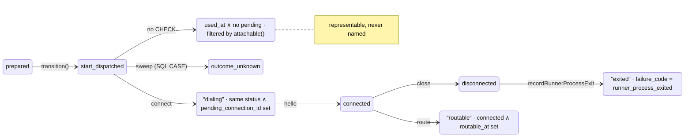
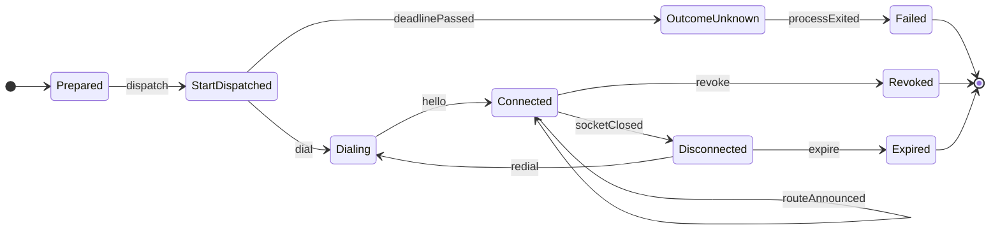

# Mermaid report

Use when Archify is unavailable and the user declines to install it, or when
`--mermaid` is given. Produce Markdown the repository already renders:
`docs/reviews/<slug>/README.md` as the overview and one
`<machine>.md` per machine, same five sections as the Archify pages.

## Before diagram

Name states by their column pattern; mark implicit ones in the label and put
the writer on the transition.



## After diagram



Keep each diagram under ~12 states; split a bigger machine into the main path
and its exits. Put the data each state carries in a table under the diagram
rather than in the state label.

## Overview

Ranked Markdown table (machine, owner, scatter today, representable illegal
state, payoff, risk); an `xychart-beta` bar chart of scattered writers versus
re-derived predicates when the renderer supports it, otherwise a table; the
"from columns to a reducer" steps as a numbered list; already-explicit list;
lower-payoff findings; a task list to decide.

## Code section

Quote the real excerpt with its path and lines in the fence title
(`` ```ts title="packages/.../runner-admission-store.ts:187-190" ``) and the
proposed code in a fence titled `(proposed)`. Keep the state union, the event
union and `apply()` complete enough to read; elide remaining rows with a
comment.
